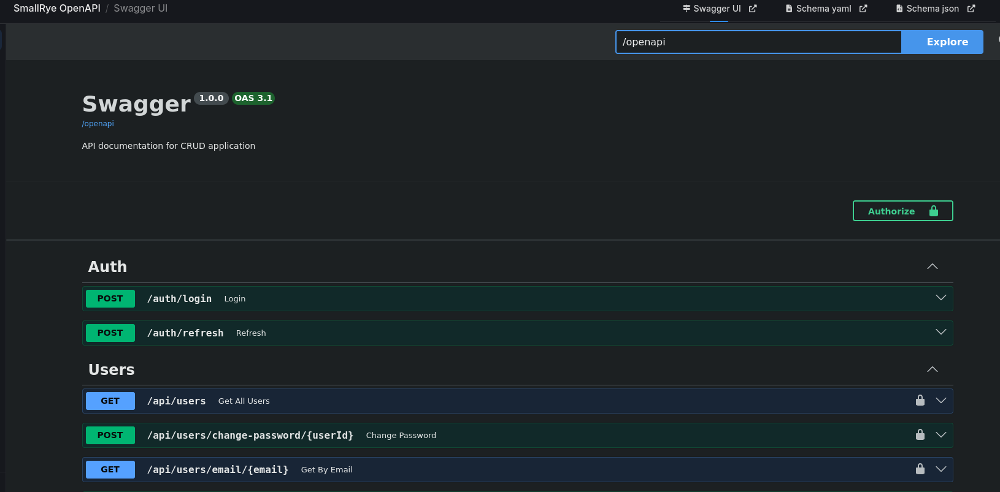
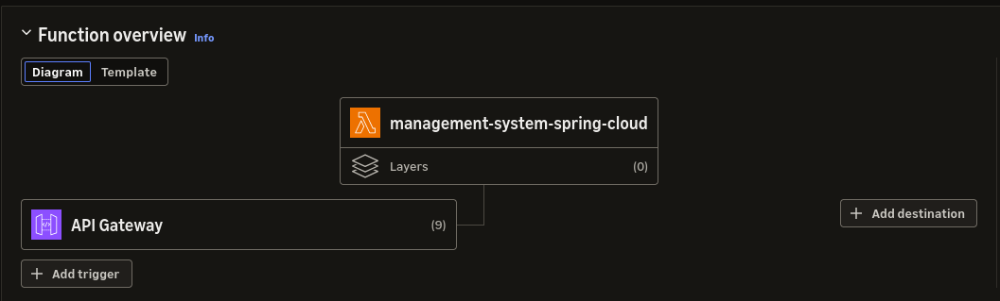
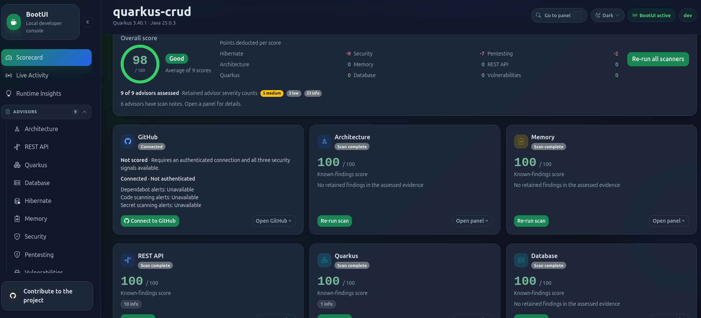

# Quarkus Crud Demo

### License: [Apache 2.0](LICENSE)

## Software and requirements

**Software architecture:** Monolithic application based on layered (n-tier) architecture using the MVC design pattern in the presentation layer.

**Software/tools:** Quarkus, Java, ORM Panache, MapStruct, Flyway, OpenAPI for Quarkus, Validations, PostgreSQL, Password4j, SmallRye JWT, AWS lambda, BootUI, Maven

**Requirements:** Java, PostgreSQL/Docker, AWS SAM CLI (Required only for AWS Lambda function)

## Description

This is monolithic application written on Quarkus and based on the project https://github.com/balantaim/management-system-spring-cloud.
The service could be used as REST backend or as AWS Lambda Function.
It is fully compatible with `management-system-frontend` and `management-system-desktop-client`.
Link to test online: [management-system-spring-cloud.vercel.app](https://management-system-spring-cloud.vercel.app/)

## Endpoints (dev profile)

- Base path:
http://localhost:5000

- Swagger docs:
http://localhost:5000/openapi

- Swagger UI base path:
http://localhost:5000/q/swagger-ui/

- Quarkus dev page:
http://localhost:5000/q/dev-ui

- Database viewer:
http://localhost:5000/q/dev-ui/quarkus-agroal/database-view

- Boot UI:
http://localhost:5000/bootui

## Postman

- Postman collection: [Collection](postman/quarkus-crud.postman_collection.json)
- Postman environment: [Environment](postman/quarkus-crud.postman_environment.json)

## Setup the project

1. **Setup datasource via Docker:**

    ```bash
    cd src/main/docker/

    docker compose -p quarkus-datasource up -d
    ```

2. Generate `public.pem` and `private.pem` keys:
    - use the following bash script:
      - A. use Java's `keytool` (Recommend)

        ```bash
           keytool -genkeypair \
           -alias management-system-key \
           -keyalg RSA \
           -keysize 2048 \
           -validity 3650 \
           -storetype PKCS12 \
           -keystore management-system.p12 \
           -storepass <YOUR_STORE_PASSWORD> \
           -keypass <YOUR_KEY_PASSWORD> \
           -dname "CN=management-system, OU=Development, L=Sofia, C=BG"

           keytool -exportcert \
           -alias management-system-key \
           -keystore management-system.p12 \
           -storetype PKCS12 \
           -rfc \
           -file public.pem

           openssl pkcs12 \
           -in management-system.p12 \
           -nocerts \
           -nodes \
           -out private-key-pkcs12.pem

           openssl pkcs8 \
           -topk8 \
           -nocrypt \
           -in private-key-pkcs12.pem \
           -out private.pem
        ```

      - B. use `openssl`

        ```bash
        openssl genrsa -out rsaPrivateKey.pem 2048
        openssl pkcs8 -topk8 -nocrypt -inform pem -in rsaPrivateKey.pem -outform pem -out private.pem
        openssl rsa -pubout -in rsaPrivateKey.pem -out public.pem
        rm rsaPrivateKey.pem
        ```

    - save the keys into `resources` folder

3. **Set property for the first application start `quarkus.flyway.migrate-at-start=true` after that turn it to** `false`
4. **Export or include environment properties for the build**
    - dev: `DEV_DB_URL`, `DEV_DB_USER`, `DEV_DB_PASS`
    - prod (Optional): `DB_URL`, `DB_USER`, `DB_PASS`, `JWT_PRIVATE_KEY`, `JWT_PUBLIC_KEY`

**Add CLI arguments for profile while running the app (NOT required):** `-Dquarkus.profile=dev`

## Run the project with dev environment

```bash
./mvnw quarkus:dev
```

## Build production jar

> [!NOTE]
> You can safely remove dependency `quarkus-amazon-lambda-http` if the project is not used as lambda.

```bash
./mvnw package -Dproduction -Dquarkus.package.jar.type=uber-jar -DskipTests
```

**Run the jar via following script:**

```bash
cd target/

java -jar <your_application_jar>
```

## Build native image (Optional)

> [!IMPORTANT]
> This step requires running Docker.

```bash
./mvnw package -Dnative -Dquarkus.native.container-build=true -DskipTests
```

The native executable will be stored in `target` folder. The target OS for the native image is `Linux`.

## Lambda Function (Optional)

You will need AWS SAN CLI tool installed in order to test and deploy it.
Build your jar or native image then test it with the following script:

- Native image:

    ```bash
    sam local start-api   --template target/sam.native.yaml
    ```

- Jar package:

    ```bash
    sam local start-api   --template target/sam.jvm.yaml
    ```

In order to deploy the lambda to AWS Cloud you will need to set up environment with API Gateway.

API Gateway configuration:
- Exposed headers `User-Id`
- Allowed headers: `Authorization`, `Content-Type`, `Client-Platform-Id`
- Allowed methods: `GET`, `POST`, `PUT`, `DELETE`, `OPTIONS`
- Set `Access-Control-Allow-Credentials`: `NO`
- Set `Access-Control-Allow-Origin`: `<your_frontend_application_domain>`
- Set your `Routes` endpoints similar like existing REST endpoints

### Default users

1. **Customer user:**
    - Username: `abv@abv.bg`
    - Password: `Pass123!`

---

2. **Admin user:**
    - Username: `admin@abv.bg`
    - Password: `Pass123!`

## Gallery





## Contact me

[](https://github.com/balantaim)
[](https://play.google.com/store/apps/dev?id=4991626043223074729)
[](https://www.linkedin.com/in/martin-atanasov-47550b1a2/)